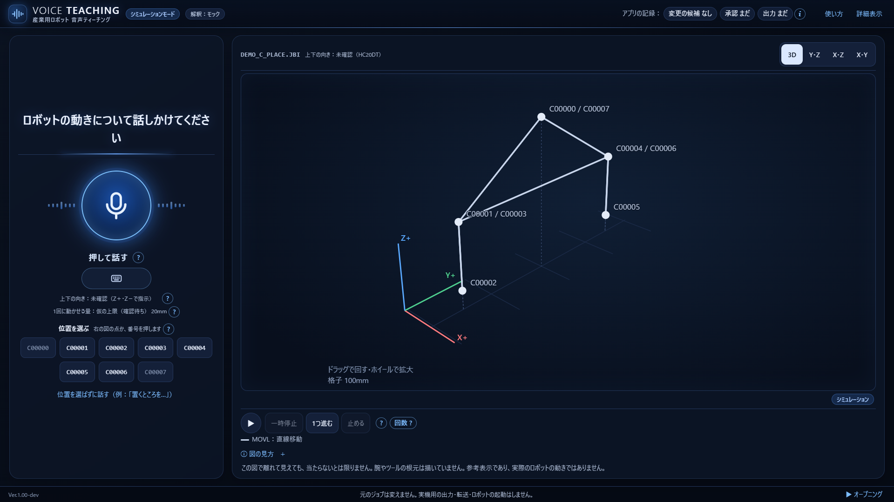
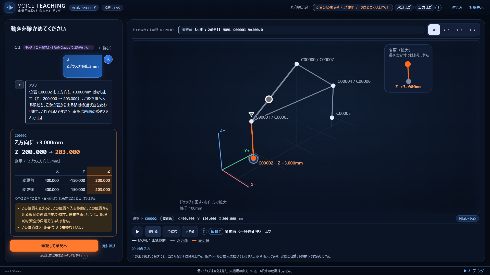
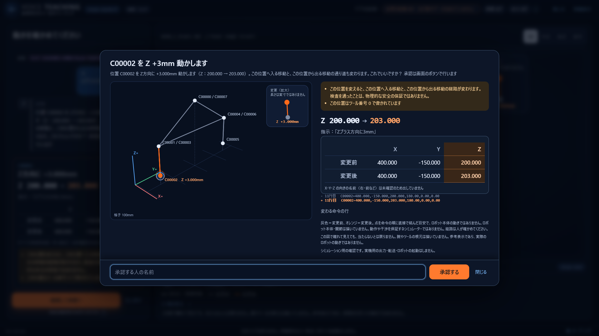
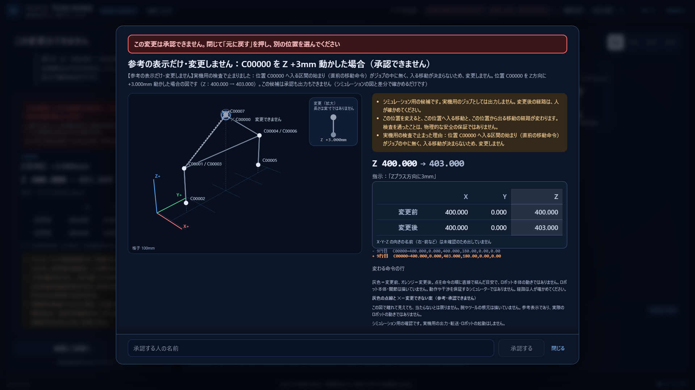

# シクロへ：撮影前のUI仕上げ

ブランチ：`ui/filming-polish`。起点：GitHub最新 `integrate/debug-1106` / `cf0b3fb`（作業前・共有前にfetchして一致確認）。mainへのmerge、8805・8813・8815の操作は行っていません。

表示の実装・検証コミット：`0625d68620043c1217c3cb48337af6eef91c436f`。後続は検証ログのUTF-8化と引継ぎ記録のみ。

## 変更範囲と競合確認

| 担当ブランチ | 変更を確認した主なファイル | 今回の扱い |
|---|---|---|
| feat/nl-demo-1106 | app.js、Pythonの自然言語・会話処理、テスト | 編集なし |
| fix/p0-reload-close | app.js、explain.js、flow.py | 編集なし |
| ui/3d-robot-base | app.js、index.html、view3d.js | 編集なし |
| 今回 | **style.css、highlight.jsの表示専用部品のみ** | 上記とファイル重複なし |

最新統合版のworktreeに未コミット変更がないことも読み取りで確認。自分専用worktree内だけで実装しています。既存HTMLへのscript追加・新規API/静的配信ルート追加は不要です。既存の`attachTips`起動時に表示部品を取り付けます。

## 画面の変更

- PCの左カラムを少し絞り、3Dに約70%の幅を確保。余白・角丸・背景・区切りを揃えました。
- 変更前後の座標を等幅の数字で大きく表示し、変更される軸をオレンジで強調。拒否された候補の表は灰色にして、承認できる案と区別します。
- 3Dの文字に細い背景色の縁取りを付け、経路と重なる位置番号を読みやすくしました。点・線・破線・座標・投影・フォントサイズの計算は変更していません。
- 図の技術的な補足2文だけを、クリック/キーボードで開閉できる **ⓘ 図の見方** にまとめました。元のDOMノード・ID・hidden属性を保ち、2D/3D切替の既存処理を維持します。
- 「この図で離れて見えても、当たらないとは限りません」等の限界の説明は常時表示。重大な警告、停止理由、承認の注意・名前欄・ボタンを折りたたんだり隠したりしていません。
- 既存の短いボタン名は維持。承認・範囲確認・拒否の色の意味、操作段階ごとの表示条件も維持しています。

## 変更ファイル

実行時に変わるのは次の2ファイルだけです。

1. `voice_teaching/web/static/style.css`：末尾の「Filming polish」ブロック。
2. `voice_teaching/web/static/highlight.js`：`attachFigureDetails`と、`attachTips`からの呼出し1行。既存の区間描画・表示値計算の関数は無変更。

追加物：`tools/preview_filming_polish.py`（独立ブラウザー検証）、本引継ぎ、`docs/ui-filming-polish/`のスクリーンショットと検証結果。

## 検証結果

| 検証 | 結果 |
|---|---|
| Chrome実画面：1920×1080 / 1280×720 / 390×844 | **44 / 44 PASS**、スクリプトエラー0 |
| 既存Node全体（色のコントラスト・音声・表示等） | **124 PASS** |
| 既存pytest：UI・ヘルプ・3D・承認後状態・review-only・debug-only | **92 PASS** |
| 修正前の表示部品で同じ操作を再実行 | 35 / 35 PASS |
| 3画面幅のSVG線分座標・破線属性 | 修正前後で**完全一致**、各9線分 |
| 保護対象13ファイル | 基準版と正規化した内容・SHA256が一致 |
| JOBの値 | C00002のX=400.000、Y=-150.000、Z=200.000→203.000をDOMで照合 |
| 警告・拒否 | 物理的安全の保証ではない旨が表示。C00000拒否時は赤い説明と承認ボタンdisabledを確認 |

テストは公開済みの合成`DEMO_C_PLACE.JBI`とモックだけです。実Claude・実マイク・実機は未使用。承認/出力のHTTPリクエスト0。自動採番の専用ポートを使い、共有3ポートへは接続していません。スクリーンショットは通常のモックサーバーで撮ったものです。シクロのdebug-only起動での承認禁止は既存サーバーの決定のままです。

途中の検証用スクリプトではCSP下の待機方法、初期のキーボード操作、基準CSSの再生用ルート引数を修正しました。これらはテスト準備の失敗であり、アプリの変更や合格として数えていません。上表は修正後に完了した検証です。

### スクリーンショット

通常画面・差分：




確認と拒否：




[1280×720](../docs/ui-filming-polish/1280-difference.png)・[小画面の確認](../docs/ui-filming-polish/390-review.png)も保存しています。小画面の確認内容は確認ボックス内でスクロールして読みます。

## シクロへの統合依頼

この専用ブランチの表示差分をレビューして、統合側で取り込んでください。こちらではmain・統合ブランチへのmergeと共有サーバーの再起動はしていません。今回の実画面確認は`cf0b3fb`に対するもので、別developerの最新変更との統合後は、図の補足開閉・候補の座標表・拒否時の承認禁止を再確認してください。

再実行：

```powershell
python tools/preview_filming_polish.py --out output/filming/recheck
node --test tests/*.test.mjs
python -m pytest tests/test_header_help.py tests/test_ui_4steps.py tests/test_ux_polish.py tests/test_3d_voice.py tests/test_c026_ui.py tests/test_after_approval_states.py tests/test_review_only.py tests/test_debug_review_only.py -q -p no:cacheprovider --basetemp=output/filming/recheck-temp
```

【開発報告】対象：撮影用UI仕上げ／実装：Codex／検証：上記／QA：上記の実測範囲でPASS／Safety：ロジック変更なし、実機安全判定ではない／未確認：他developer変更との統合後・実マイク・実機／残存リスク：基準版に残る会話P0は本UIでは解消しない／ブランチ：ui/filming-polish／統合：シクロ待ち、mainへのmergeなし。

## 会社退出前の引き渡し更新

**UIは完成・push済みで、撮影用として引き渡し可能です。追加のUI実装待ちはありません。** シクロはUIを取り込む前のまま8815の基本動作確認を続けてください。UI統合を急いで、会話・再読み込みの修正と同時に入れ替える必要はありません。

- 公開済み：`ui/filming-polish`、表示実装`0625d68`、最初の引き渡し`04e2479`。[Draft PR #3](https://github.com/RyutanCAMP/voice-teaching/pull/3)。
- 優先した3点：技術補足のⓘ化、座標・見出しの文字整理、確認/拒否ボタンの視認性。警告・承認内容・表示条件・安全制限は維持。
- 最新の撮影用統合版`5645ceb`のgit-archiveを独立コピーし、UI2ファイルだけを重ね、Chromeで**44/44 PASS**を再確認。新しい3D台座表示と今回のUIが共存する状態も視認しました。
- 確認中に追加された`3a60a72`は引き継ぎ・レビュー記録のみで、検証済み版との実行時コード差分0。統合側では`style.css`・`highlight.js`の変更がなく、今回とのファイル競合0。
- 共有worktree・統合ブランチへの書込み、merge、8805/8813/8815への接続・再起動はしていません。検証は自動採番ポート、モック・公開合成JOBのみ。
- この更新の変更は本引き継ぎと検証証拠のみ。UIの実行時コードは追加変更していません。

[統合版との確認結果](../docs/ui-filming-polish/integration-check/results.json)・[起点と競合の記録](../docs/ui-filming-polish/integration-check/provenance.json)・[新しい3Dとの画面](../docs/ui-filming-polish/integration-check/1920-difference.png)・[確認画面](../docs/ui-filming-polish/integration-check/1920-review.png)。

### 残件と明日の撮影判定

UI単体の未完成項目はありません。アプリ全体の撮影可否は、**8815での実音声・撮影台本の通し確認が終わるまで保留**です。以下はUI担当の変更範囲外として、シクロ側の引き継ぎと分けて残します。

1. シクロが基本動作を確認した後にUIを統合し、1920×1080・表示倍率100%で最終表示を確認する。今回の独立コピー検証を、稼働中8815の確認済みと扱わない。
2. 統合側の既存残件：回数確認の「はい」での汎用エラー、H02/H16を含む候補後の言い直し・取消、Claudeの説明が非表示になるケース。今回のUIで直したり覆い隠したりしていない。
3. 3Dの原点高さ・据え付けの確認と、他developerのレビュー指摘の反映は各担当で確認する。

**撮影用UIは準備完了。撮影アプリ全体の無条件合格や、実機利用可の判定ではありません。** 未解決の会話・安全関連事項を、見た目の完成を理由に解決済みへ変更していません。

## シクロへの実行順序の確定（唐川さんの追加指示）

明日の撮影ではPR #3のUIを使う希望を受領。ただし **Safety High再検証 → 統合版の基本動作確認 → UI統合 → 回帰テスト → 8815反映 → 唐川さんの画面確認** の順序を守ります。今日は帰宅前のため、新たな機能修正は増やしていません。

### 今回進めた確認

- 撮影用統合ブランチは`ea9211e`（実行時コードは`4fa07c5`）。統合側の引き継ぎにも、今の8815は確定版ではなく、Safety Highの再検証が先と明記されています。
- High-1修正`5a1208e568423fb4f42c8df2ac6723db98c8f89e`を固定した独立コピーで、`test_nl_demo_1106.py`と`test_acceptance_nl_safety_1105.py`を再実行：**413 PASS / 17 XFAIL**。17件は既知P0の期待失敗であり、解消・成功には数えません。
- 元の再現2件（選び直し／元に戻す後の古い向き確認）と、説明・回数変更を挟んだ追試4経路では、候補なし・can_approve=false・向き未確定を確認。旧ボタンは「もう使えません」で拒否されました。WebFlow直接呼出し・モック・合成JOBのみ、ポート・実APIは未使用です。
- 最初のpytest試行はコピー先のTEMP親フォルダ不足で起動エラーとなり、フォルダ準備後に新しいTEMPで完了した上記結果と分離しました。
- **これは5a1208eの局所確認であり、最新の会話修正全体へのSafety PASSではありません。** その後の回数変更修正`d6f6a7c`と、developer側の未コミット変更を確認しています。担当の作業ツリーは編集していません。

### 今日の停止位置と次回の手順

1. 会話developerの最新変更を確定SHAでcommit・pushし、そのSHAでHigh-1と後続変更を再レビューする。未解消のHighを残したまま次へ進めない。
2. 検証済みの会話修正を撮影用統合ブランチへ取り込み、JOB読み込み・対象選択・聞き返し・上限拒否・候補・承認/出力・読み直しによる旧画面無効化の基本動作を確認する。既知の失敗は別欄に残す。
3. その後、[PR #3](https://github.com/RyutanCAMP/voice-teaching/pull/3)を`integrate/filming-1106`へ取り込む。mainにはmergeしない。取り込み前に2つの表示ファイルの競合を再確認する。
4. 統合後のpytest・Node・169件の意味評価・ブラウザー回帰を実行し、退行と残件を記録する。UI44件の合格を全体の回帰完了へ読み替えない。
5. 条件が整ってから8815だけへ反映し、実際に起動したSHAを記録する。**8805は変更しない。** 最終画面は唐川さんに確認いただき、そのあと撮影に使う版を決める。

**現時点ではPR #3はDraftのまま、UI統合・8815反映は未実施です。** 稼働中の8805/8815は操作していません。UIの準備は完了していますが、撮影アプリ全体の最終判定は引き続き保留です。

## 8815の実配信照合と追加デザイン依頼の扱い

唐川さんから、8815がまだ情報過多に見えるとの指摘と、**PR #3が未反映なら追加修正せず、まず反映後の画面を見る**との指示を受領しました。

### 実配信の確認結果：PR #3は未反映

- 撮影用worktree `C:/アプリ/vt-film` のHEAD：`ea9211ebaf5e4e442bb16042ec50102617460915`。実行時コードの基準は`4fa07c5`。PR #3の表示実装`0625d68`はこのHEADの祖先に含まれません。
- `http://127.0.0.1:8815/static/style.css`と`/static/highlight.js`をキャッシュ抑止指定のHTTP GETで取得。
- **配信中の2ファイルとも、ea9211eのファイル・撮影用worktreeのディスク内容と一致し、PR #3の0625d68とは不一致**（CRLF/LFを正規化したSHA256で比較）。
- CSSの`Filming polish`ブロック、JSの`attachFigureDetails`も配信内容にありません。GitHubでもPR #3はDraft・未merge。
- [比較証拠](../docs/ui-filming-polish/live-8815-check/comparison.json)を保存。ここで示すSHAはworktreeのHEADと静的ファイルの照合であり、サーバープロセスの起動時SHAを取得したという意味ではありません。

今回は配信ファイルの読み取りだけです。POST、再起動、差し替え、統合、表示コードの編集はしていません。8805には接続・変更していません。

### 今回は実装せず保留する整理項目

PR #3反映後の唐川さんの画面確認を先に行い、その結果を踏まえて必要なものだけ表示に限定して着手します。

- 通常画面中央のマイクを主役にし、ヘッダーのモデル名・モード・細かい状態は詳細へ移す。
- 通常の説明・補足・制限値の案内をⓘへ。重大な警告・実際の上限超過等の停止理由・承認差分は目立つ状態を維持する。
- 位置番号一覧の必要時展開、操作段階ごとの情報表示を検討する。
- 3D下部の一般的な注意・図の説明を「ⓘ 図の見方」にまとめ、余白と3D領域を優先する。
- 再生・一時停止・コマ送りのデザインを統一し、「回数？」を短く意味の分かる表現へ整理する。
- 下部の「シミュレーション」を「動作プレビュー」等へ変えるか検討する。実機動作の保証と誤解される表現にしない。
- JOB番号ラベルの重なりを改善する。位置データ・経路・台座・正面方向の現在の基本表示は維持する。

Safety High再検証とシクロの統合を優先する順序は変更ありません。**新デザインの実装は開始せず、PR #3反映後の画面確認待ち**とします。最新の引き継ぎ変更は、この記録と静的ファイルのハッシュ比較だけです。

## 本日の作業終了・シクロへの引き渡し

唐川さんの指示で、本日はここで終了します。終了時にも8815のCSS/表示JSをHTTP GETで再照合し、両方ともea9211eと一致・PR #3の0625d68とは不一致でした。**PR #3未反映のため、追加のUI修正はしていません。**

- 成果：`ui/filming-polish` / [PR #3](https://github.com/RyutanCAMP/voice-teaching/pull/3)。表示実装は0625d68のまま。後続コミットは証拠・引き継ぎのみ。完成済みのコード・画面・検証結果はpush済み。
- シクロへの依頼：Safety Highと基本動作を先に確認し、PR #3を撮影用統合ブランチへ取り込み、回帰テスト後に8815へ反映。その画面を唐川さんが見て最終版を決める。8805は変更しない。
- 残件：反映後も必要なら、ヘッダーの細かい状態、マイク周辺の通常補足、3D下部の一般説明を優先して整理する。明日の撮影に影響する表示だけを対象とする。
- 安全警告・承認差分/内容・停止理由は隠さない。安全処理、位置データ・経路・台座・正面方向は変更しない。
- 本日の終了時点では、UI統合・8815の入れ替え・mainへのmergeは行っていない。稼働サーバーの変更なし。実行時コードの未コミット変更なし。
